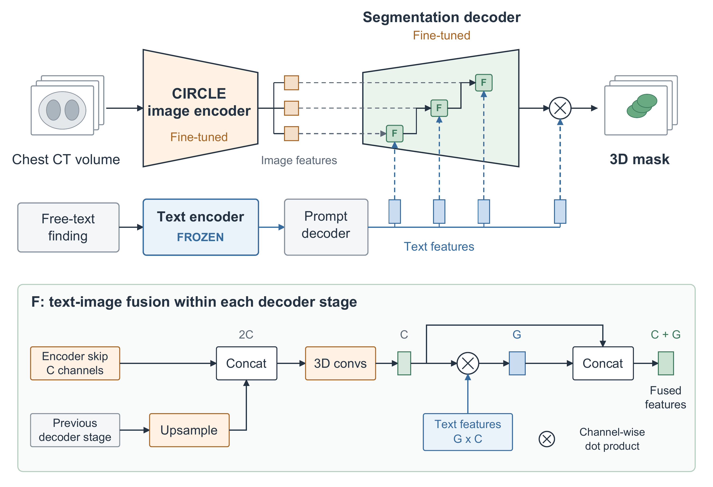

# ReXGrounding Challenge paper: CIRCLE team method description (Appendix A)

## Data

Segmentation training used 2,992 ReXGroundingCT scans with paired findings and masks. CIRCLE was pretrained on 403,500 chest non-contrast CT scans from 288,740 patients, paired with radiology reports.

Additional in-house data comprised 950 scans from the CIRCLE cohort at Zhongshan Hospital, Fudan University, Shanghai, China: 800 pulmonary nodule scans and 150 challenging scans covering lung cancer, pneumonia/other infections, and less common thoracic conditions. Positive finding descriptions were extracted from each radiology report. Annotation engineers with medical backgrounds exhaustively delineated all image-visible abnormalities corresponding to each extracted finding, yielding paired descriptions and 3D masks.

No test-set images or text were used in training, including component pretraining.

## Pre-processing

CT volumes were resampled to a voxel spacing of 0.65 × 0.65 × 1.15 mm, with an input size of 384 × 320 × 224 voxels. 

## Architecture and text encoder

CIRCLE pretraining jointly learns image–report alignment and abnormality recognition. A 3D adaptation of EfficientNetV2-XL and a Chinese BERT-based report encoder project CT volumes and reports into a shared 512-dimensional space. A SigLIP-style contrastive objective aligns image–report pairs, while a parallel classification head uses binary cross-entropy to predict 37 thoracic abnormalities from report-derived labels. This joint objective encourages clinically discriminative visual representations without voxel-level supervision.

For grounding, we integrate this pretrained image encoder into VoxTell [1]. A prompt decoder conditions segmentation on features from a frozen Qwen3-Embedding-4B text encoder. The image encoder and segmentation decoder are fine-tuned.

## Training

Segmentation training used Dice plus binary cross-entropy loss, AdamW (initial learning rate: 3 × 10⁻⁴), and batch size 24, requiring approximately two days on eight H20 GPUs. 

## Ensembling

Predicted probability maps from different epoch checkpoints were averaged voxel-wise. 

## Post-processing

The averaged probability map was binarized at a threshold of 0.5. No additional post-processing was applied.

## Inference time and hardware

Inference required approximately 20 s per scan per finding on a single H20 GPU. 

## Final submission and lessons

The final submission is listed as “CIRCLE” on the leaderboard. On the reported 50-case validation subset, pretraining increased mean Dice from 0.277 with random initialization to 0.327, compared with 0.282 for VoxTell. Additional in-house data further increased mean Dice to 0.356. These comparisons suggest benefits from pretraining and additional annotations, whereas random initialization did not improve over VoxTell. 

## Code and weights availability

Code is publicly available on https://github.com/uii-open-source/CIRCLE/. Model weights are not publicly released.

## Figure (optional)

**Figure A1. Overview of CIRCLE for text-prompted 3D segmentation.** The pretrained CIRCLE image encoder is integrated with a VoxTell-based decoder [1] to segment the finding specified by the text prompt. The image encoder and segmentation decoder are fine-tuned, while the text encoder remains frozen.

## References

[1] Rokuss M, Langenberg M, Kirchhoff Y, et al. VoxTell: Free-Text Promptable Universal 3D Medical Image Segmentation. arXiv:2511.11450, 2025. https://doi.org/10.48550/arXiv.2511.11450
